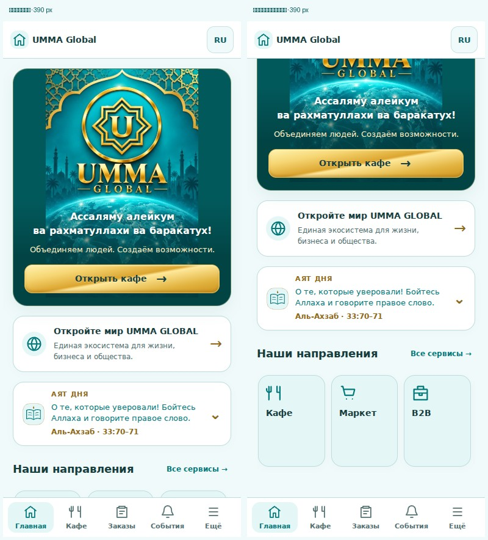

# UMMA GLOBAL — главная страница

Изменения основаны на main `8100a7187964c9bb8a8ac794e29cb4afb556801d` и сохраняют опубликованные исправления Корана.

## Реализовано

- Компактный баннер с оригинальным фирменным рисунком без изменения пропорций. На ширине 390 px высота 389 px вместо примерно 537 px (−28%). На 320 px высота увеличивается для полного приветствия.
- Утверждённое приветствие для всех пользователей, новый слоган, золотая кнопка кафе с защитой от повторного нажатия и состоянием занятости.
- Адаптивный WebP 480×720 (81 КБ вместо 385 КБ), srcset/sizes, зарезервированные размеры изображения и версии обновлённых ресурсов.
- Карточка экосистемы и страница «О UMMA GLOBAL»: миссия, ценности, 38 направлений из существующего реестра, статусы и переходы. Использован существующий механизм диалогов и возврата.
- Компактный аят дня с названием суры и ссылкой, раскрытием оригинала и полного перевода. Кнопка Корана открывает непосредственно суру и аят дня. Смена по времени Нячанга, данные Корана и тафсира сохранены.
- Шесть быстрых направлений: кафе, Market, B2B, образование, туры и отель. Горизонтальная прокрутка со snap; полный реестр остаётся в «Ещё».
- Русская, английская и вьетнамская локализация. Существующая верхняя панель, пять вкладок и Telegram Safe Area сохранены.

## Проверки

`npm test` — успешно: кафе, заказы, платежи, курьеры, уведомления, Market, B2B, 17 языков и Коран.
После финальных изменений повторены `qa-native-shell`, `qa-quran`, `qa-i18n` и проверка синтаксиса/пробелов.

Браузер Chromium: 320, 360, 375, 390, 414, 430, 768 и 1024 px × RU/EN/VI — 24 сочетания. Нет переполнения страницы и основных блоков, изображения загружены, кнопка кафе ≥44 px, нижняя навигация остаётся в окне. Проверены горизонтальная прокрутка, страница о проекте и её переводы, раскрытие аята и переход к чтению. Нет JavaScript-исключений. Протокол: [browser-results.json](browser-results.json).

Повторить браузерную проверку (Playwright и Chromium устанавливаются отдельно, не входят в приложение):

```sh
PLAYWRIGHT_MODULE=/absolute/path/to/playwright QA_CHROMIUM_PATH=/absolute/path/to/chromium QA_OUTPUT_DIR=/tmp/umma-home-qa node scripts/qa-home-browser.mjs
```



## Ограничения проверки

Браузерные проверки используют локальные файлы и блокируют внешние сетевые запросы. Существующие API проверяются автоматическими тестами с изолированными данными. Реальные заказы не создавались. Физические Telegram Android/iOS недоступны; локальный Android JVM-тест требует Java-компилятор и выполняется в CI. Отдельного этапа сборки у статического приложения нет: публикуются исходные HTML/CSS/JS через существующий GitHub Pages.

Изменений схемы Supabase, серверных функций, авторизации и данных продаж нет.
